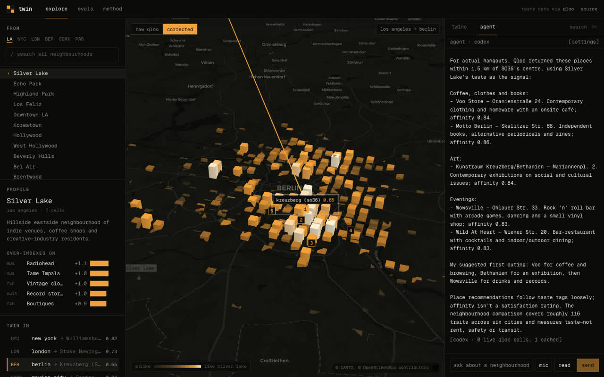

<p align="center">
  
</p>

<p align="center">
  Find the Silver Lake of Berlin. Twin matches neighbourhoods across cities by what their residents and visitors actually like —<br>
  measured with <a href="https://qloo.com">Qloo</a> taste data, corrected for the popularity bias we found in it, and wrapped in an agent that helps you act on the answer.
</p>

<p align="center">
  <a href="#how-it-works">how it works</a> ·
  <a href="#evals">evals</a> ·
  <a href="#the-agent">agent</a> ·
  <a href="#run-it">run it</a> ·
  <a href="web/content/writeup.md">full write-up</a>
</p>

<p align="center"></p>

## What it does

| | |
|---|---|
| **Explore** | Pick a neighbourhood and every ~1 km block of its city lights up. Pick another city and the camera flies there; blocks rise by similarity and the five closest neighbourhoods are ranked, with the traits they share and where they differ. |
| **Drop a pin** | Click any block to use that exact cell as the source — not just a named neighbourhood. |
| **Raw vs corrected** | One toggle shows the same map on raw Qloo scores, where everything busy looks alike. |
| **Agent** | A chat tab that reasons with an LLM (local Codex CLI, or your own Anthropic/OpenAI key) and calls Qloo live for venues, audiences and brands near the twin. |
| **MCP server** | The same ten tools, usable from Claude Code, Codex or any MCP client. |

## How it works


Raw Qloo heatmap affinity tracks Qloo's own popularity score at **r = 0.97**: busy cells score high for everything, so on raw scores every neighbourhood looks the same (mean cross-city cosine **0.95**). Twin subtracts that:

```
r[c,i]  = percentile of cell c for item i, within its city      116 items × 6 cities, geohash-6 cells
v[c,i]  = z_i( r[c,i] − mean_j r[c,j] )                           ← the cell's popularity baseline, removed
v[hood] = mean of v[c] for cells within 1.3 km
twins   = top cosine(v[A], v[hood]) in the target city
```


## Evals

All labels were committed before any result was computed (ground truth `edf9056`, census hypotheses `4965b70`). Losses are reported next to wins.

| Question | Result |
|---|---|
| Does the correction separate places? | Mean cross-city cosine **0.95 → 0.16**; best–worst spread per city **0.11 → 0.73** |
| Does the corrected map match the US census? (36 pre-registered tests, LA + NYC) | Corrected beats raw in **21 / 36**. Latin artists ↔ % Hispanic ρ **0.29 → 0.64**; soul food ↔ % Black **0.29 → 0.67**. Worse on affluence (luxury ↔ income turns negative). |
| Does it find twins people already name? (21 held-out published pairs) | **An LLM with no data wins** — MRR 0.67 vs Twin 0.34 (raw 0.38, random 0.16). It has read the same articles. Twin reaches hit@3 0.45 from taste data alone vs 0.12 random. |


So the product's claim is the honest one: the LLM reasons and knows the famous answers; Qloo supplies measured, block-level taste for everywhere nobody has written about. The agent uses both.

## The agent



| Tool | Source |
|---|---|
| `list_cities`, `search_hoods`, `find_twins`, `explain_match`, `taste_profile`, `where_in_city`, `pin_twins` | precomputed fingerprints |
| `local_scene` — venues near a neighbourhood, steered by the source's taste | Qloo, live |
| `audience` — age and gender skew of an artist or brand | Qloo, live |
| `cross_domain` — brands that fans of an artist over-index on | Qloo, live |

Runtimes: **Codex CLI** (default when `codex` is on your PATH), **Anthropic** or **OpenAI** with a key you paste in the panel (sent per request, never stored server-side), or an offline rule-based fallback. MCP: `cd web && pnpm mcp` — config snippets in [`web/README.md`](web/README.md).

## Run it

```bash
cd web
pnpm install
pnpm dev                       # http://localhost:3000
```

The app ships with precomputed data in `web/public/data`. For the live agent tools, add your hackathon key to `web/.env.local`:

```
QLOO_API_KEY=...
QLOO_BASE_URL=https://hackathon.api.qloo.com
```

Rebuild the data (cached, so re-runs are free): put the same two variables in `.env` at the repo root, then `cd pipeline && python3 run_all.py`.

## Layout

```
pipeline/        Python, stdlib only — basket, fetch, correction, twins, evals, census check
web/             Next.js — globe, explore, evals, method, blog, agent, MCP server
web/content/     the write-up (rendered at /blog)
probe/           the first experiments that found the popularity bias
```

<p align="center"><br><sub>MIT · built for the <a href="https://qloo.devpost.com/">Qloo Agentic Hackathon</a></sub></p>
