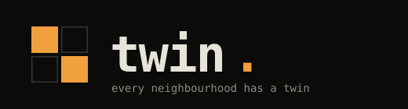
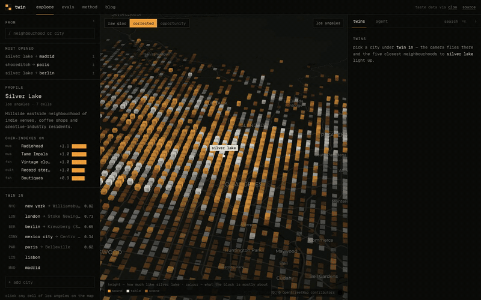
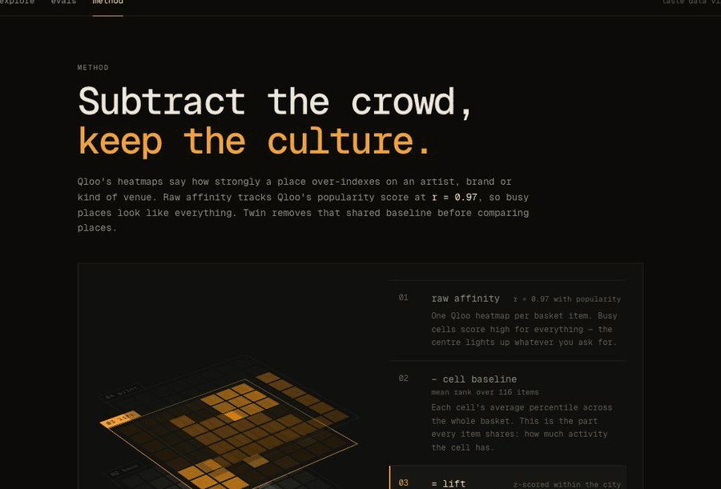
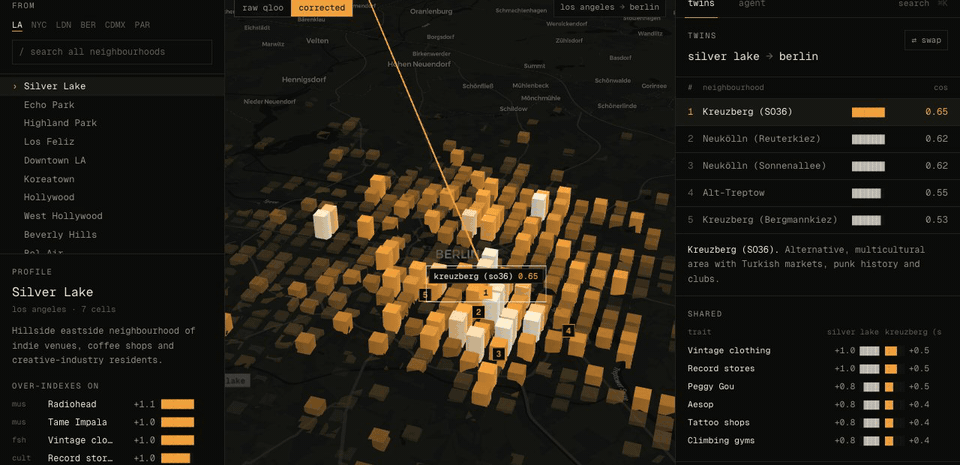
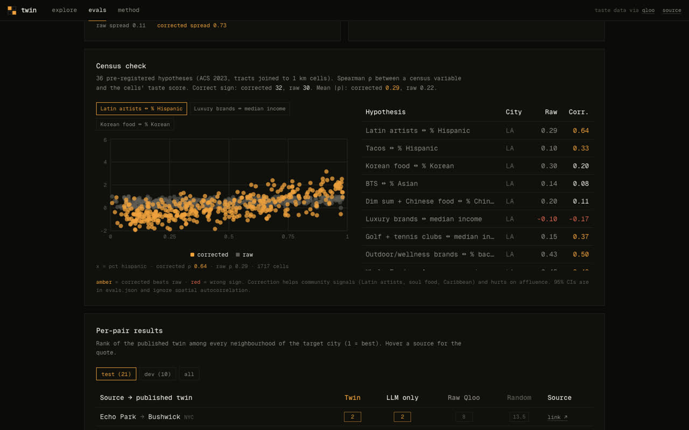
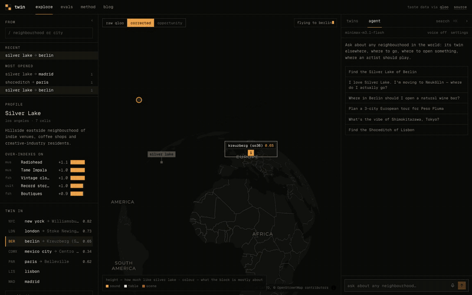

<p align="center">
  
</p>

<p align="center">
  Find what works in one neighbourhood, and where it works next. Twin matches neighbourhoods across cities by what people there actually like —<br>
  measured with <a href="https://qloo.com">Qloo</a> taste data, corrected for the popularity bias we found in it — and an agent turns the match into a report:<br>
  where to open a place, where to expand, where to move, where to tour.
</p>

<p align="center">
  <a href="#how-it-works">how it works</a> ·
  <a href="#evals">evals</a> ·
  <a href="#the-agent">agent</a> ·
  <a href="#run-it">run it</a> ·
  <a href="web/content/writeup.md">full write-up</a>
</p>

<p align="center"></p>

## What it does

| | |
|---|---|
| **Explore** | Pick a neighbourhood and every ~1 km block of its city lights up. Pick another city and the camera flies there; blocks rise by similarity and the five closest neighbourhoods are ranked, with the traits they share and where they differ. |
| **Reports** | Ask for a report and the agent follows one of seven playbooks and writes an analyst-style brief: GO / WATCH / SKIP verdict, key numbers, market, customers, candidates compared, competitors, a benchmark abroad, scorecard, risks, validation plan. Every chart and headline number is checked against the tool output. Share link, server-rendered PDF, Markdown. |
| **Report on the map** | An open report numbers its shortlist on the map and flies to its city; every place in the text moves the map. |
| **Twin vs a plain AI** | One click asks a model without Twin's tools; every place it names is checked on OpenStreetMap. |
| **Gap scan** | What recurs in a neighbourhood's twins abroad and is missing at home. |
| **Brand whitespace** | Where a chain is (10,000 chains, Overture) and the busy blocks that match its branches but have none within 1 km. |
| **Lookalike sites** | Blocks in any of 24 cities like your own best locations. |
| **Site check** | One address: busyness, taste, venue mix, chains nearby, twins abroad. |
| **Read a block** | Height = likeness, colour = what it's mostly about (sound · table · scene). Hover for its traits and how many venues stand there; *ask* sends that block to the agent. |
| **Taste vs popularity** | One toggle shows the same map on raw Qloo scores, where everything busy looks alike. |
| **24 cities, and any other** | Six with the full 116-trait fingerprint, eighteen more built from live Qloo heatmaps (Lisbon, Tokyo, Barcelona, Amsterdam, Madrid, Rome, Milan, Melbourne, Sydney, Toronto, Chicago, San Francisco, Austin, Seoul, São Paulo, Buenos Aires, Istanbul, Vienna). Any other city is built in under a minute the first time someone asks. |
| **Agent** | 29 tools on free models (Gemini 3.5 Flash-Lite first, then other Gemini and OpenRouter models, failing over mid-run; a report takes 11–20 s), streamed as a timeline. Reports keep running if you close the tab; a username (no password, a sync code) keeps your history across devices. |
| **Opportunity map** | Busy blocks first, then Qloo demand for a taste vs how many such venues physically exist (Overture Maps). |
| **MCP server** | The same tools, usable from Claude Code, Codex or any MCP client. |

## How it works



Raw Qloo heatmap affinity tracks Qloo's own popularity score at **r = 0.97**: busy cells score high for everything, so on raw scores every neighbourhood looks the same (mean cross-city cosine **0.95**). Twin subtracts that:

```
r[c,i]  = percentile of cell c for item i, within its city      116 items × 6 cities, geohash-6 cells
v[c,i]  = z_i( r[c,i] − mean_j r[c,j] )                           ← the cell's popularity baseline, removed
v[hood] = mean of v[c] for cells within 1.3 km
twins   = top cosine(v[A], v[hood]) in the target city
```



## Evals

All labels were committed before any result was computed (ground truth `edf9056`, census hypotheses `4965b70`). Losses are reported next to wins.

| Question | Result |
|---|---|
| Does the correction separate places? | Mean cross-city cosine **0.95 → 0.16**; best–worst spread per city **0.11 → 0.73** |
| Does the corrected map match the US census? (36 pre-registered tests, LA + NYC) | Corrected beats raw in **21 / 36**. Latin artists ↔ % Hispanic ρ **0.29 → 0.64**; soul food ↔ % Black **0.29 → 0.67**. Worse on affluence (luxury ↔ income turns negative). |
| Does it find twins people already name? (21 held-out published pairs) | **An LLM with no data wins** — MRR 0.67 vs Twin 0.34 (raw 0.38, random 0.16). It has read the same articles. Twin reaches hit@3 0.45 from taste data alone vs 0.12 random. |
| Does taste predict where real chains open? (457 chains, 2,246 city-to-city pairs, Overture) | Twin AUC **0.714**, but raw popularity does better (0.786): chains follow footfall. **Among equally busy blocks** taste still ranks real sites above others — **0.691** for taste-led chains (Pret, Uniqlo, Pandora) vs 0.547 for convenience (Lidl, 7-Eleven). So the agent ranks by busyness first, then taste. |



So the product's claim is the honest one: the LLM reasons and knows the famous answers; Qloo supplies measured, block-level taste for everywhere nobody has written about. The agent uses both.

## The agent



Qloo makes every taste decision; the other sources only do jobs Qloo can't:

| Question | Source | Tools |
|---|---|---|
| Twins, vibe, venue picks (hours, price), audiences, brands, momentum, demand | **Qloo** + Twin fingerprints | `find_twins`, `twins_anywhere`, `scene`, `local_scene`, `audience`, `cross_domain`, `compare_taste`, `trend`, `opportunity`, `tour`, `add_city` … |
| How many venues of a kind exist | Overture Maps Places (precomputed) | `venue_supply`, `opportunity` |
| Coordinates, new-city neighbourhoods | OpenStreetMap | `geocode`, `add_city` |
| Background facts | Wikipedia / Wikidata | `wiki` |
| Current events, news, closures | Web (Tavily) | `web_search`, `read_page` |

Full tool reference and the agent's playbook prompt: [`docs/AGENT.md`](docs/AGENT.md) (generated from the code).

**Try:** *make me a report: where in Berlin should I open a natural wine bar?* · *make me a report: my café works in Shoreditch — where in Lisbon next?* · *find the Silver Lake of Berlin* · *plan a 3-city European tour for Peso Pluma* · *what's the vibe of Shimokitazawa, Tokyo?* · *find the Shoreditch of Lisbon*

## Run it

```bash
cd web
pnpm install
pnpm dev                       # http://localhost:3000
```

The app ships with precomputed data in `web/public/data`. Put the keys in `web/.env.local`:

```
QLOO_API_KEY=...                      # Qloo hackathon key
QLOO_BASE_URL=https://hackathon.api.qloo.com
OPENROUTER_API_KEY=...                # free models; visitors can also bring their own
TAVILY_API_KEY=...                    # optional: web search
GEMINI_API_KEY=...                    # optional: Google AI Studio, tried first
KV_REST_API_URL=...                   # optional: shared store (Upstash Redis) for cache, reports, usernames;
KV_REST_API_TOKEN=...                 #   files under web/.cache otherwise
```

Rebuild the data (cached, so re-runs are free): put the same two variables in `.env` at the repo root, then `cd pipeline && python3 run_all.py`.

## Layout

```
pipeline/        Python — basket, fetch, correction, twins, evals, census check, Overture venue supply, chain backtest (DuckDB)
web/             Next.js — globe, explore, evals, method, blog; AI SDK agent; MCP server
web/content/     the write-up (rendered at /blog)
probe/           the first experiments that found the popularity bias
```

<p align="center"><br><sub>MIT · built for the <a href="https://qloo.devpost.com/">Qloo Agentic Hackathon</a></sub></p>
